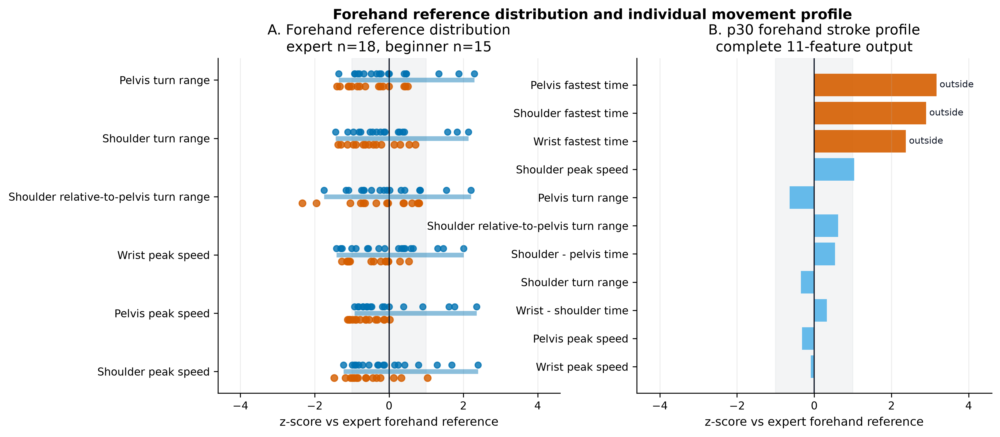
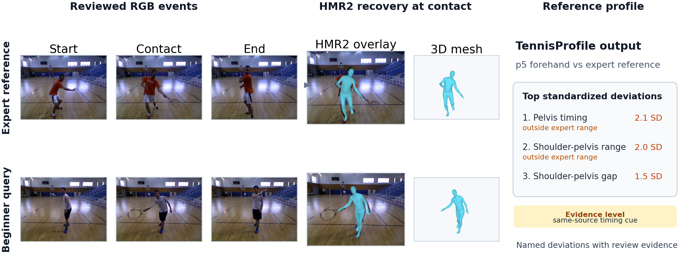
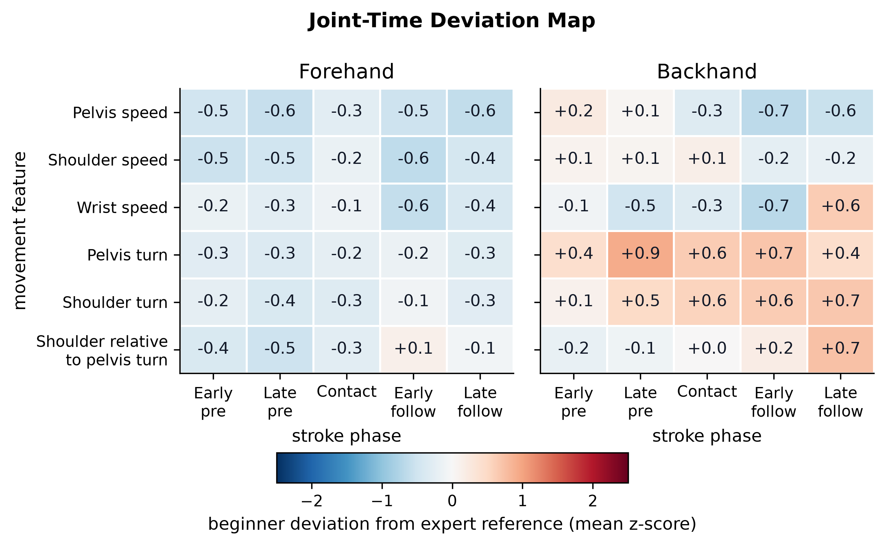

# TennisProfile

**Reliability-Aware Groundstroke Profiling from Monocular 3D Human Recovery**

[](https://eccv.ecva.net/)
[](https://github.com/pengjk0-dotcom/TennisProfile/releases/tag/v0.1.1)
[](LICENSE)
[](DATA_LICENSE.md)

**Accepted at the MoCha workshop at ECCV 2026.** TennisProfile is a reproducible research project that transforms monocular 3D human-recovery outputs into *stroke-specific, expert-referenced* tennis motion profiles, with explicit attention to evidence reliability.

**[Visual overview](#visual-overview) · [Poster overview](docs/POSTER.md) · [Key findings](#key-findings) · [Reproduce](#reproducibility) · [Latest release](https://github.com/pengjk0-dotcom/TennisProfile/releases/tag/v0.1.1) · [Cite](#citation)**

## Visual overview



TennisProfile connects reviewed stroke events, 3D body motion, and expert-reference comparisons. The project studies *what differs*, *where in the swing it differs*, and *how strongly the evidence supports the comparison*.

### Project at a glance

| Input and method | Research output |
| --- | --- |
| Monocular RGB groundstroke clips | Reviewed swing-start, ball-contact, and swing-end events |
| HMR2 human mesh recovery | Joint-motion representation and 11 scalar motion features |
| Five contact-anchored phases | Six-variable × five-phase deviation maps |
| Stroke-specific expert reference | Standardized feature deviations and reliability-aware interpretation |



## Evaluation cohort

**36 subjects · 72 reviewed strokes · 2 stroke types**

- 18 expert-reference subjects, 3 held-out experts, and 15 beginners.
- One flat forehand and one one-handed backhand per retained subject.
- The fixed selection was made independently of final feature values; see the [cohort audit](reproducibility/subject_selection_audit.csv).
- The retained cohort is right-handed and limited in setting; it must not be presented as validation across every stroke, handedness, or in-the-wild camera view.

## Key findings

These are **study-specific descriptive results**, not product accuracy claims:

| Evaluation | Observed result | Evidence |
| --- | --- | --- |
| Mean absolute expert-reference deviation | **0.49 SD** held-out experts vs **0.76 SD** beginners | [Robustness summary](results/camera_ready_robustness_summary.json) |
| Feature values outside the expert reference min–max | **0.0%** held-out experts vs **9.7%** beginners | [Robustness summary](results/camera_ready_robustness_summary.json) |
| External cross-source comparison | Evaluated on **20 SportsPose tennis sequences from 4 subjects** | [SportsPose validation](results/sportspose_external_validation_summary.json) |

The held-out expert group contains only three subjects; these comparisons should not be read as a generalizable classifier benchmark. The camera-ready robustness analysis also reports **no two-sided group-feature discoveries at BH q < 0.05**. See the full [statistical and robustness results](results/) before drawing stronger conclusions.



Additional figures: [phase summary](figures/fig5_key_phase_deviation_summary.png) · [boundary sensitivity examples](figures/fig_supp_boundary_examples.png) · [SportsPose/HMR2 visual check](figures/fig_sportspose_hmr2_overlay_qc.png).

## Poster

The [**ECCV 2026 MoCha poster companion**](docs/POSTER.md) presents the research motivation, method, representative figures, reference-based profile, major results, and reliability limitations in a visual reading order.

> The GitHub companion is an accessible, reformatted version of the poster content; it is not an additional experiment or a replacement for the original high-resolution presentation file.

## Reproducibility

The repository makes available only material that can be redistributed: reviewed event tables, fixed cohort splits, derived motion features, group summaries, robustness results, figure assets, analysis scripts, and recorded environments.

**Verify the released tables** (Python standard library only):

```bash
python3 scripts/verify_release.py
```

**Reproduce analyses from included feature tables:**

```bash
python3 -m venv .venv
source .venv/bin/activate
python -m pip install --upgrade pip
python -m pip install -r reproducibility/requirements.txt
python scripts/run_camera_ready_robustness.py --skip-sportspose
```

Omit `--skip-sportspose` and set `SPORTSPOSE_ROOT` only if you have a licensed local SportsPose checkout. The [release checksums](MANIFEST.sha256) apply to the files listed there on the branch where they appear; historical `v0.1.1` checksums remain available at the [tagged release](https://github.com/pengjk0-dotcom/TennisProfile/releases/tag/v0.1.1).

### Reproduction levels

| Level | Requirements |
| --- | --- |
| **Released-table reproduction** | Included split, annotations, feature tables, and scripts |
| **Feature recomputation** | Licensed source videos and recorded HMR2 skeleton outputs |
| **Full HMR2 inference** | Original third-party code, checkpoint, SMPL assets, and environment |

Full acquisition and licensing boundaries are documented in [THIRD_PARTY_ASSETS.md](THIRD_PARTY_ASSETS.md) and [HMR2_RUNTIME.md](reproducibility/HMR2_RUNTIME.md).

### Repository map

| Directory | Contents |
| --- | --- |
| [data/](data/) | Reviewed events, study split, derived features, and summaries |
| [results/](results/) | Cohort, robustness, perturbation, and external validation analyses |
| [figures/](figures/) | Paper and supplementary figures |
| [scripts/](scripts/) | Verification, HMR2 conversion, analysis, and figure generation |
| [reproducibility/](reproducibility/) | Environment pins, runtime records, and audit data |
| [docs/POSTER.md](docs/POSTER.md) | GitHub-friendly poster companion |

## From TennisProfile to AENSYRA

**TennisProfile is the reproducible research study; [AENSYRA](https://aensyra-web.pengjk0.workers.dev/) is a separately evolving, user-facing tennis-analysis product.**

The study's approach to stroke-event definition, motion representation, expert-referenced profiling, and reliability-aware interpretation helped inform the product's research direction. The AENSYRA application has its own engineering, inference, scoring, and interface development; **its current implementation and any claims of product accuracy are not established by this repository**.

## License and citation

Original source code: [MIT License](LICENSE). Original annotations and derived tables: [CC BY 4.0](DATA_LICENSE.md), only where the authors hold rights. No third-party media, HMR2 checkpoints, or SMPL assets are redistributed.

For a machine-readable citation, see [CITATION.cff](CITATION.cff) and GitHub's **Cite this repository** menu. Until a proceedings DOI is assigned, the software release can be cited as:

```bibtex
@software{peng2026tennisprofile,
  author  = {Peng, Jinkun},
  title   = {TennisProfile: Reliability-Aware Groundstroke Profiling from Monocular 3D Human Recovery},
  year    = {2026},
  version = {0.1.1},
  url     = {https://github.com/pengjk0-dotcom/TennisProfile}
}
```
