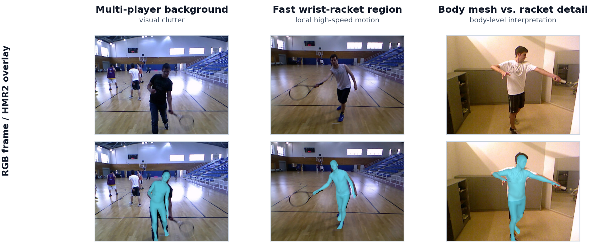
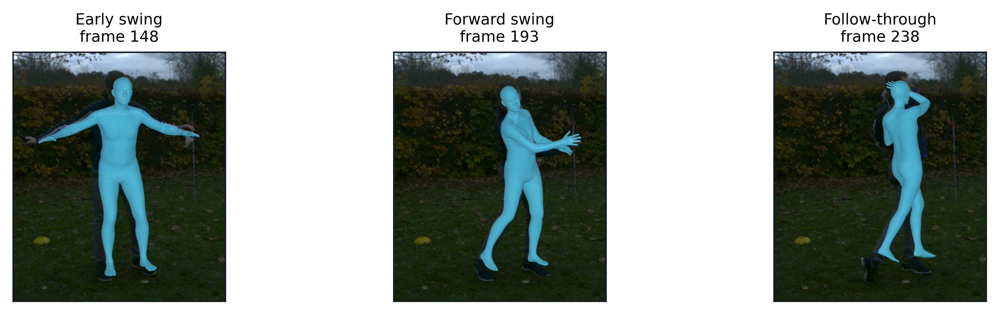

# TennisProfile — ECCV 2026 MoCha Poster

**TennisProfile: Reliability-Aware Groundstroke Profiling from Monocular 3D Human Recovery**

**Jinkun Peng · Independent Researcher · MoCha @ ECCV 2026**

*This page is a GitHub-friendly companion to the author's original conference poster: its narrative and reported quantities follow that poster, with representative figures already released in this repository. It is not a pixel-exact export of the presentation.*

[← Project home](../README.md) · [Reproducibility release](https://github.com/pengjk0-dotcom/TennisProfile/releases/tag/v0.1.1) · [Citation](../CITATION.cff)

## Why this work?

Stroke labels tell **what happened**, but not **how movement differs from expert technique**. Dense monocular 3D recovery alone does not make an interpretable training profile: it also requires named motion variables, localized swing phases, and clear evidence levels.

## From monocular RGB to a reference profile

**Research pipeline:** Monocular RGB → reviewed start / contact / end → HMR2 + SMPL joint motion → 11 scalar features + 6 variables across 5 phases → stroke-specific expert reference → top deviations, phase map, and evidence level.

The five-phase representation is anchored at the reviewed ball-contact event and normalized across the preparation/contact/follow-through interval. Scalar features cover **timing, rotation range, and peak speed**; reference deviations are standardized within each stroke type.

## Evaluation and findings

The fixed analysis cohort includes **18 reference experts, 3 held-out experts, and 15 beginners** (36 subjects; 72 reviewed forehand and one-handed-backhand strokes).

| Poster finding | Observation | Interpretation |
| --- | --- | --- |
| Mean absolute distance to expert reference | **0.49 vs 0.76 SD** (held-out experts vs beginners) | Descriptive comparison in this fixed split |
| Outside reference min–max range | **0.0% vs 9.7%** (held-out experts vs beginners) | Not a classification-accuracy estimate |
| Matched SportsPose/HMR2 relative difference | **15.4% vs 43.2%** (rotation-range vs peak-speed features) | Cross-source support was stronger for rotation range in the poster analysis |

The poster also reports **14/15 beginners** with lower pelvis peak angular speed under its forehand comparison (*BH q = 0.005* for the stated directional test). This should not be confused with an across-the-board significant improvement: the [camera-ready robustness analysis](../results/camera_ready_robustness_summary.json) reports **no two-sided group-feature discoveries at BH q < 0.05**.

## Where deviations occur

The poster emphasizes forehand differences around the contact-window speed variables; backhands also show pre-contact pelvis-rotation differences. The figure is a descriptive group map, not a personalized diagnosis.

## Reliability is part of the result

The poster distinguishes evidence categories rather than presenting all features as equally reliable:

- **Rotation range:** strongest support in the matched cross-source comparison.
- **Fastest-motion timing:** informative within a source, but sensitive to sampling and event definition.
- **Peak speed:** motion-sensitive cue requiring careful interpretation and validation.

The external SportsPose subset comprises **20 sequences / 4 subjects at 90fps**, and is used as an external 3D-pose check—not a labeled stroke-skill benchmark or an independently reviewed contact-event evaluation.

## Scope and limitations

This is a bounded research cohort, not a claim of universal tennis coaching accuracy. All retained subjects in the published cohort were right-handed; available camera conditions and the held-out expert group were limited. Recovery errors, phase annotations, frame-rate changes, and source differences can affect motion measures. Consult the [full tables](../results/), [cohort audit](../reproducibility/subject_selection_audit.csv), and [third-party asset terms](../THIRD_PARTY_ASSETS.md).

## Research to product

This project informed the research direction of **[AENSYRA](https://aensyra-web.pengjk0.workers.dev/)**, a separately developed tennis motion-analysis product. The poster does not validate the current product's inference accuracy or represent a release of AENSYRA's commercial implementation.

**[Return to TennisProfile](../README.md)** · **[How to cite](../CITATION.cff)**
